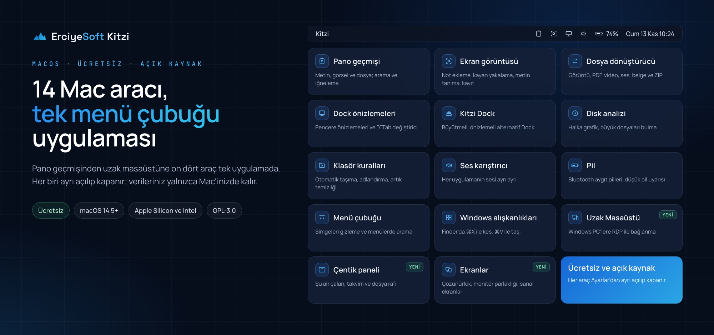
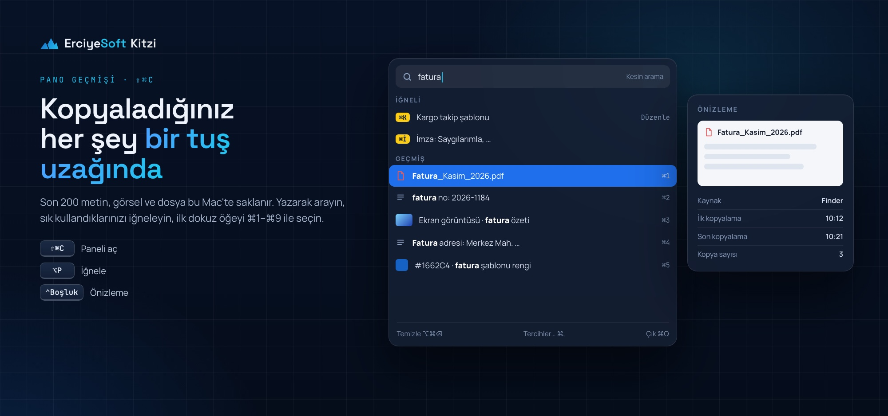
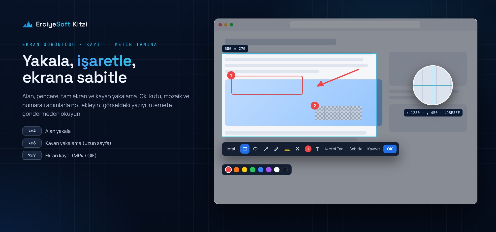
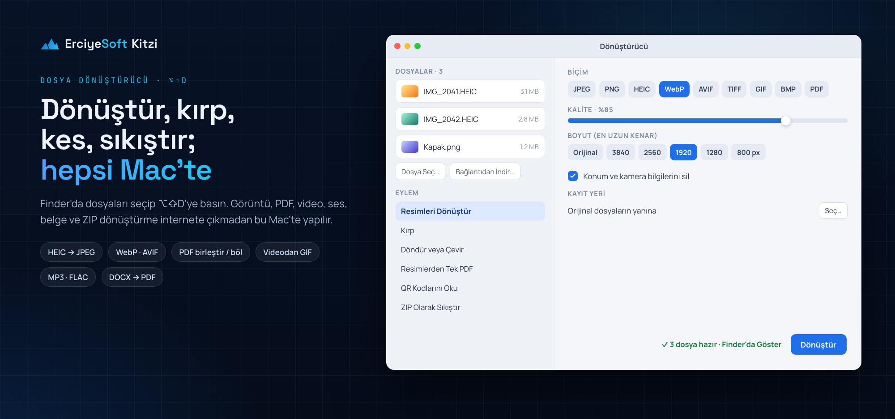
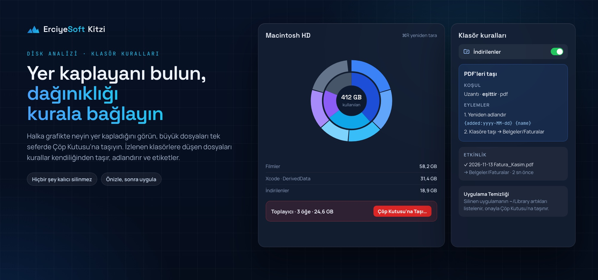
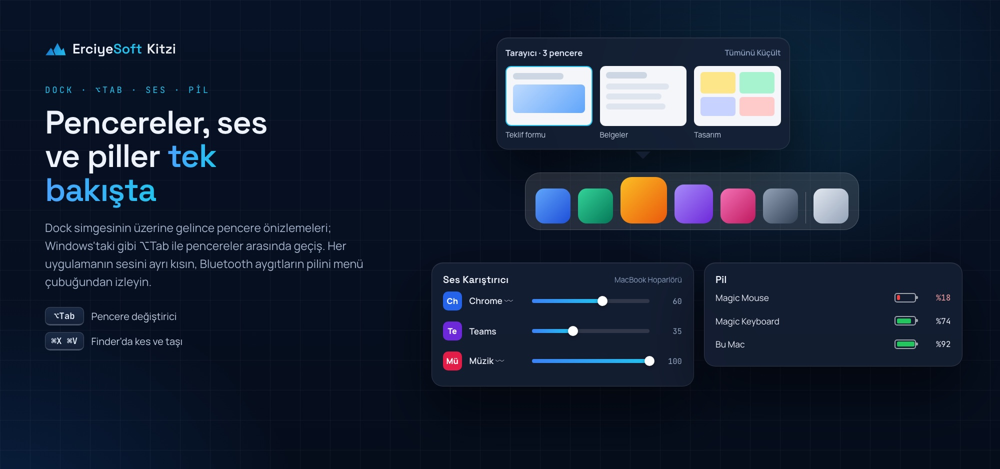
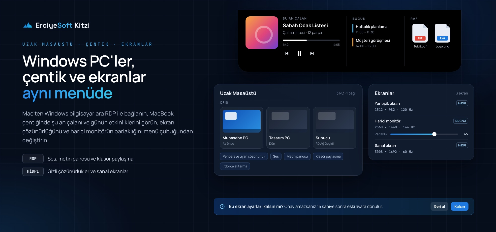

# Kitzi



**İndir:** [son sürüm (.dmg)](https://github.com/ErciyeSoft/Kitzi/releases/latest) · macOS 14.5 ve üstü, Apple Silicon ve Intel. İlk açılışta macOS "doğrulanamadı" derse Sistem Ayarları › Gizlilik ve Güvenlik bölümünden **Yine de Aç**'a basın.

[ErciyeSoft](https://www.erciyesoft.com) tarafından geliştirilen, ücretsiz ve açık kaynak (GPL-3.0) bir macOS menü çubuğu uygulaması. Tanıtım sayfası: [erciyesoft.com/urunlerimiz/kitzi-ucretsiz-mac-uygulamasi](https://www.erciyesoft.com/urunlerimiz/kitzi-ucretsiz-mac-uygulamasi). İçinde şunlar var:

- **Pano geçmişi** — metin, resim ve dosya geçmişi, arama, pinleme, ⇧⌘C ile açılan panel ([Maccy](https://github.com/p0deje/Maccy) çatalı, MIT).
- **Dock** — Dock üzerinde pencere önizlemeleri, Alt+Tab pencere değiştirici, Cmd+Tab iyileştirmeleri, hareketler ve widget'lar ([DockDoor](https://github.com/ejbills/DockDoor) çatalı, GPL-3.0).
- **Kitzi Dock** — macOS Dock'unun yerine geçebilen, büyütmeli ve pencere önizlemeli kendi Dock'umuz (ayarlardan açılır).
- **Ekran görüntüsü** — alan/pencere/ekran yakalama, üzerine not ekleme, kopyalama, kaydetme, sabitleme ve metin tanıma.
- **Ses karıştırıcı** — Teams, Chrome gibi uygulamaların sesini ayrı ayrı kısma ve kapatma (Windows'taki gibi), menü çubuğundan.
- **Pil** — Mac'in ve Bluetooth klavye/fare/kulaklıkların pil seviyeleri menü çubuğunda; düşük pil bildirimi (kendi kodumuz).
- **Dosya dönüştürücü** — görüntü, PDF, video, ses, belge ve ZIP dönüştürme; Finder'da sağ tık › Hizmetler › "Kitzi ile Dönüştür" ya da ⌥⇧D. Yalnızca macOS çerçeveleri ve yerleşik araçlar (`textutil`, `afconvert`, `ditto`) kullanılır.
- **Windows alışkanlıkları** — Finder'da ⌘X ile kesip ⌘V ile taşıma (Finder'ın "Öğeyi Buraya Taşı" komutuyla); dosya adı yazarken tuşlar her zamanki gibi çalışır.
- **Disk analizi** — diskleri ve klasörleri tarayıp halka grafikte gösterme, büyük dosyaları toplayıp Çöp Kutusu'na taşıma ([DaisyDisk](https://daisydiskapp.com) örnek alındı, kodu alınmadı).
- **Menü çubuğu** — menü çubuğu simgelerini gizleme, hep gizli bölüm, arama ve kısayollar ([Bartender](https://www.macbartender.com) örnek alındı, kodu alınmadı; varsayılan kapalı).
- **Klasör kuralları** — izlenen klasörlerdeki dosyaları kurallara göre taşıma, yeniden adlandırma, etiketleme ve temizleme; silinen uygulamaların artıklarını bulma ([Hazel](https://www.noodlesoft.com) örnek alındı, kodu alınmadı).
- **Uzak Masaüstü** — Windows PC'leri gruplar ve favorilerle saklama, RDP ile Kitzi penceresinde bağlanma (ses, metin panosu, klasör paylaşma, pencereye uyan çözünürlük, RD Ağ Geçidi); Windows App'te kayıtlı PC'leri ve .rdp dosyalarını içe aktarma ([Windows App](https://learn.microsoft.com/windows-app/) örnek alındı, kodu alınmadı; bağlantı [FreeRDP](https://www.freerdp.com) ile).
- **Çentik** — MacBook çentiğinden açılan panel: şu an çalan (kapak, ilerleme, oynat/duraklat/atla), bugünkü takvim etkinlikleri, dosyaları sürükleyip bırakacağın bir raf ve şarj bildirimi; istersen ses ve parlaklık göstergesi de macOS'unkinin yerine burada çıkar. Çentiksiz ekranlarda menü çubuğunun ortasında bir hap olarak gösterilebilir ([boring.notch](https://github.com/TheBoredTeam/boring.notch) örnek alındı; ölçüler ve medya tuşu işleme ondan uyarlandı, GPL-3.0).
- **Ekranlar** — her ekranın çözünürlüğü ve yenileme hızı (HiDPI ve macOS'in gizlediği modlar dahil; 15 sn içinde onaylanmayan değişiklik geri alınır), harici monitörlerde DDC/CI ya da yazılımsal karartmayla parlaklık, karşıtlık ve ses, imlecin altındaki monitör için parlaklık tuşları, yansıtma, ana ekran seçimi ve özel HiDPI boyutlar için sanal ekranlar ([BetterDisplay](https://github.com/waydabber/BetterDisplay) örnek alındı; kapalı kaynak, kodu alınmadı).

## Ekran görüntüleri

<table>
<tr>
<td width="50%"><br><b>Pano geçmişi</b></td>
<td width="50%"><br><b>Ekran görüntüsü ve not ekleme</b></td>
</tr>
<tr>
<td width="50%"><br><b>Dosya dönüştürücü</b></td>
<td width="50%"><br><b>Disk analizi ve klasör kuralları</b></td>
</tr>
<tr>
<td width="50%"><br><b>Dock önizlemeleri, ses ve pil</b></td>
<td width="50%"><br><b>Uzak Masaüstü, çentik ve ekranlar</b></td>
</tr>
</table>

## Kaynak alınan projeler

İki proje bir kez kopyalandı, birinden de kod uyarlandı; upstream takip edilmiyor. Kaynak alınan commit'ler:

| Proje | Commit | Lisans |
|---|---|---|
| Maccy | `f0b571e` (2.8.0 sonrası) | MIT — `LICENSES/Maccy-MIT.txt` |
| DockDoor | `baf6425` | GPL-3.0 — `LICENSES/DockDoor-GPL-3.0.txt` |
| boring.notch | `b7611bb` | GPL-3.0 — `LICENSES/boringNotch-GPL-3.0.txt` |

DockDoor GPL-3.0 olduğu için birleşik uygulama da GPL-3.0'dır (`LICENSE`). Kendi kullanımın için sınırlama yok; uygulamayı başkasına dağıtırsan kaynak kodunu da vermen gerekir.

Uzak Masaüstü'nün RDP motoru depoya kopyalanmaz, çünkü çok büyük: `Vendor/FreeRDP/build.sh` sabitlenmiş sürümleri resmi kaynak arşivlerinden tek bir statik kitaplığa derler ve uygulama ona statik bağlanır.

| Proje | Sürüm | Lisans |
|---|---|---|
| FreeRDP (RDP istemcisi) | 3.33.1 | Apache-2.0 — `LICENSES/FreeRDP-Apache-2.0.txt` |
| OpenSSL (FreeRDP'nin TLS'i) | 3.5.9 | Apache-2.0 — `LICENSES/OpenSSL-Apache-2.0.txt` |

## Yapı

```
App/                 Ana uygulama: giriş noktası, ortak ayar penceresi, kaynaklar
  Resources/         Varlık katalogları, string kataloğu, Maccy dil tabloları, sesler
Modules/
  KitziCore/        Modüller ile ana uygulamanın paylaştığı tipler (SettingsPage, KitziFeature)
  ClipboardKit/      Pano modülü (Swift 6, varsayılan MainActor)
  DockKit/           Dock modülü (Swift 5 dil modu)
  BatteryKit/        Pil modülü
  DockBarKit/        Kitzi Dock
  CaptureKit/        Ekran görüntüsü aracı
  VolumeKit/         Uygulama başına ses (Core Audio process tap)
  WindowsKit/        Windows alışkanlıkları (Finder'da kes-yapıştır)
  DiskKit/           Disk analizi (halka grafik, toplayıcı)
  MenuBarKit/        Menü çubuğu simgelerini gizleme ve arama
  RulesKit/          Klasör kuralları ve App Sweep (FSEvents)
  NotchKit/          Çentik paneli: şu an çalan, raf, takvim, ses/parlaklık göstergesi
  DisplayKit/        Ekranlar: çözünürlük, DDC/CI parlaklık, sanal ekranlar (macOS'in yayımlamadığı arayüzler tek dosyada)
  ConvertKit/        Dosya dönüştürücü (ImageIO, PDFKit, AVFoundation, yerleşik komutlar)
  RemoteKit/         Uzak Masaüstü: kayıtlı PC'ler, oturum pencereleri (Swift)
  RDPBridge/         RemoteKit ile FreeRDP arasındaki küçük C katmanı
Vendor/              Üçüncü parti kodun kaynak kopyaları (Defaults, KeyboardShortcuts, ...); bkz. Vendor/README.md
project.yml          XcodeGen proje tanımı (Kitzi.xcodeproj buradan üretilir)
```

**Dış bağımlılık yok:** Swift Package Manager, CocoaPods ya da hazır derlenmiş `.dylib`/`.framework` kullanılmaz. Gereken üçüncü parti kod `Vendor/` altına kaynak olarak kopyalanır ve her şey statik olarak tek `Kitzi` çalıştırılabilir dosyasına derlenir. Bu yüzden DockDoor'un "Şu an çalan" medya widget'ı şimdilik boş: upstream bunu `/usr/bin/perl` içine ayrı bir dylib yükleyerek yapıyordu. Çentik modülü aynı bilgiyi dylib olmadan, Apple'ın `/usr/bin/osascript` aracında çalışan küçük bir JavaScript betiğiyle okuyor (`Modules/NotchKit/NotchMediaRemote.swift`); Dock widget'ı da ileride bu yolla doldurulabilir.

Her özellik `KitziFeature` protokolünü uygulayan statik bir framework'tür. Yeni bir özellik eklemek için `Modules/` altına modül açıp `project.yml`'a hedef olarak ekle ve `App/Sources/AppDelegate.swift` içindeki `features` listesine koy; ayar sayfaları otomatik olarak ortak ayar penceresine gelir.

Kaynaklar (resim, dil, ses) bilerek ana uygulamada durur: iki upstream kod da `Bundle.main` üzerinden okuduğu için modüllerin içine taşınmadı.

## Derleme

Uzak Masaüstü'nün kullandığı FreeRDP ve OpenSSL, sabitlenmiş ve sağlama toplamı denetlenen kaynak arşivlerinden bir kez derlenir (birkaç dakika sürer; `cmake` ve `ninja` gerekir). Çıktı `Vendor/FreeRDP/out/` altına yazılır ve git'e girmez:

```bash
brew install cmake ninja
```

```bash
Vendor/FreeRDP/build.sh
```

```bash
xcodegen generate
```

```bash
xcodebuild -project Kitzi.xcodeproj -scheme Kitzi -configuration Debug -skipMacroValidation -skipPackagePluginValidation build
```

İmza `Apple Development` sertifikasıyla yapılır; böylece Erişilebilirlik ve Ekran Kaydı izinleri her derlemede sıfırlanmaz. Derlemeden önce `project.yml` içindeki `DEVELOPMENT_TEAM` alanına kendi Apple geliştirici ekip kimliğinizi yazın ve `xcodegen generate` komutunu yeniden çalıştırın.

İndirme paketleri (.dmg ve .zip) `.github/workflows/release.yml` ile GitHub Actions'ta derlenir: Actions sekmesinden "Run workflow" ya da `v*` etiketi yeni bir sürüm yayınlar.

## İzinler

- **Erişilebilirlik** — pano öğesini yapıştırmak, Dock/pencere işlemleri, Finder'da ⌘X/⌘V, menü çubuğu araması, çentikteki ses/parlaklık göstergesi ve parlaklık tuşlarını imlecin altındaki harici monitöre yönlendirmek için.
- **Takvim** — çentikte bugünkü etkinlikleri göstermek için; paneldeki düğmeye ilk basışta sorulur.
- **Ekran Kaydı** — Dock önizlemelerindeki pencere görüntüleri için.
- **Bluetooth** — klavye, fare ve kulaklıkların pil seviyesini okumak için.
- **Sistem sesi kaydı** — ses karıştırıcının uygulama sesini seçilen seviyede yeniden çalması için.
- **Otomasyon › Finder** — ⌥⇧D ile Finder'da seçili dosyaları dönüştürücüye almak için.
- **Tam Disk Erişimi** (isteğe bağlı) — disk analizinin korunan klasörlerin boyutunu da görebilmesi için. Verilmezse okunamayan klasörler ayrıca gösterilir.
- **Masaüstü, Belgeler, İndirilenler** — klasör kuralları bu klasörleri izlerken macOS bir kez sorar.
- **Diğer uygulamaların verileri** — Uzak Masaüstü, Windows App'teki kayıtlı PC'leri içe aktarırken macOS bir kez sorar. Windows App'in parolaları okunmaz; Kitzi'nin parolaları giriş anahtar zincirinde durur.

Yol haritası: [docs/ROADMAP.md](docs/ROADMAP.md).
